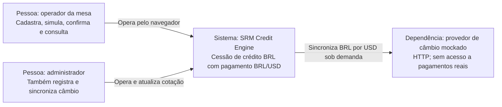
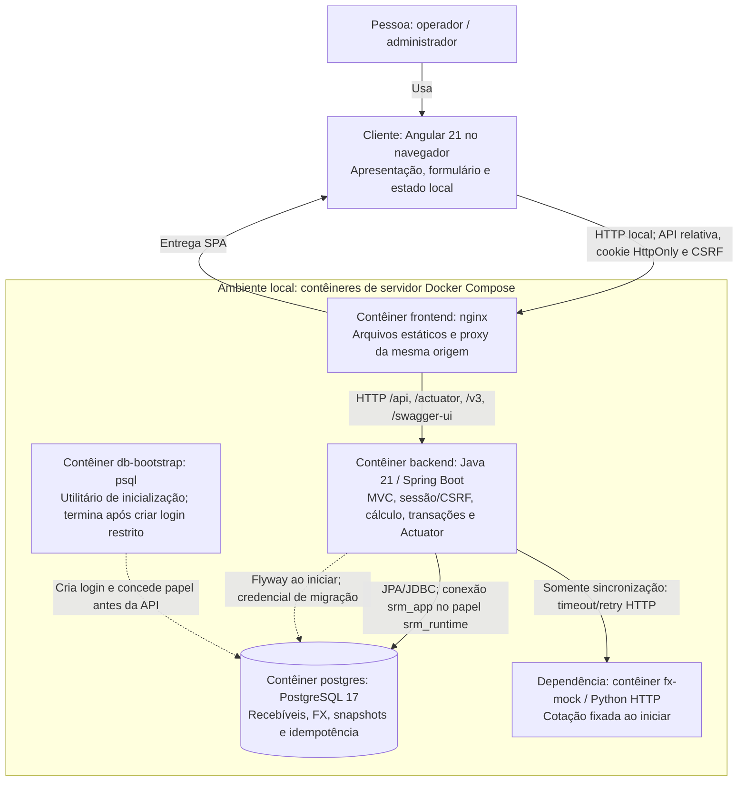

# C4 — contexto e contêineres implementados

Os diagramas representam a execução local atual, não uma proposta de serviços distribuídos. Os limites e a política financeira estão em [DECISIONS](../DECISIONS.md) e [SPEC](../SPEC.md). [ER implementado](er.md).

## Nível 1 — contexto do sistema

O sistema registra aquisição de recebíveis e seu histórico. Não transfere dinheiro, gerencia caixa bancário ou se integra a outros fundos. O provedor é simulado; indisponibilidade não impede BRL ou USD com cotação local válida. Todos os operadores autorizados veem o mesmo fundo nesta demonstração.

## Nível 2 — contêineres

Angular roda no navegador, embora o bundle seja construído/servido pelo contêiner frontend. Comunicação de negócio passa pelo proxy e pela API; o browser não acessa PostgreSQL ou o mock diretamente. nginx serve `/health` e encaminha as rotas de API/diagnóstico. Readiness/liveness vêm da API; o mock tem healthcheck independente e não é dependência de prontidão do backend.

O backend é um monólito organizado em controller → service → model/repository, com DTOs e configuração de suporte. Não são contêineres de deployment distintos. A transação financeira usa JPA e JDBC sobre a mesma conexão; o extrato usa três consultas em snapshot REPEATABLE READ. O cálculo puro e as strategies não dependem de HTTP, Spring ou Micrometer. [Detalhes das camadas](architecture.md).

Logs JSON são enviados a stdout e métricas ficam nos endpoints Actuator protegidos por sessão. Não há Prometheus, coletor de logs ou broker rodando no Compose. Sessões e métricas residem na memória do processo; histórico/idempotência residem no volume PostgreSQL. A conta Flyway ainda está no processo da API durante esta demonstração; separar migrations em um job é uma evolução documentada, não uma garantia já entregue.

As portas publicadas ficam em loopback, com configuração externa. Compose espera banco saudável, bootstrap concluído e API saudável antes de iniciar nginx. Healthcheck do frontend confirma entrega estática; falha do banco deve ser diagnosticada pela readiness da API. [Execução, diagnóstico e limites](operations.md).
