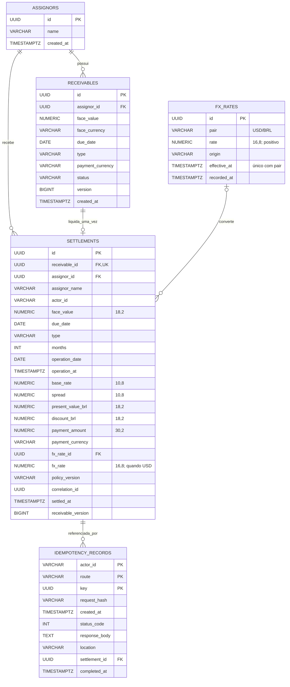

# Modelo relacional implementado

Os blocos 2 a 4 implementam cedentes, recebíveis, histórico de câmbio, liquidações e registros idempotentes. Todas as tabelas abaixo participam dos fluxos implementados.

Migration: `V1__create_assignors_and_receivables.sql`. Face usa NUMERIC(18,2), com valor positivo e moeda BRL. CHECKs restringem tipo, moeda de pagamento, estado e versão. A FK impede excluir um cedente referenciado. Índices atendem consulta por cedente, estado e ordem de criação. `@Version` usa a coluna version para detecção otimista de alterações concorrentes.

A elegibilidade por vencimento é validada pela aplicação usando Clock e data de operação, sem CHECK dependente do relógio do banco. A confirmação muda AVAILABLE para SETTLED e incrementa version na mesma transação da auditoria; não há edição geral de recebíveis.

`V2__create_fx_rates.sql` cria FX_RATES, única por `(pair, effective_at)`, com CHECK de par USD/BRL, cotação positiva e origem não vazia. NUMERIC(16,8) preserva até 99999999.99999999. Instantes têm precisão de microssegundos. O índice por par/vigência/registro atende a seleção temporal; vigências futuras são válidas para armazenamento.

V3 cria liquidações únicas por recebível, snapshots financeiros e idempotência por ator/rota/chave. A auditoria também guarda origem e instantes de vigência/registro cambial. CHECKs verificam balanço face=VP+deságio, moedas/tipos/prazo e presença do snapshot cambial em USD ou ausência em BRL. Pagamento NUMERIC(30,2) suporta a divisão pela menor cotação; o limite do tipo é testado no PostgreSQL real.

O resultado idempotente guarda JSON como TEXT, preservando os bytes e o status/Location originais. Reservas sem resultado só existem durante a transação; um constraint trigger diferido rejeita commit incompleto. V4 concede permissões ao papel srm_runtime e impede alteração/exclusão do histórico; somente completar uma reserva é permitido, com trigger que rejeita reescrita de confirmação. Detalhes em [credenciais](database.md).

Verificação: `./mvnw -Dtest=ReceivablesIntegrationTest,SettlementSchemaTest,SettlementIntegrationTest test`. Inclui migrations em banco limpo, constraints, login restrito real, precisão, disputa da mesma versão, rollback e replay. Índices adicionais do extrato serão aferidos no bloco 5.

A FK settlement_id da idempotência não possui UNIQUE: o banco admite múltiplos registros apontando para a mesma liquidação. O protocolo normal cria um resultado por intenção confirmada; o diagrama não impõe uma cardinalidade 1:1 inexistente no schema.
