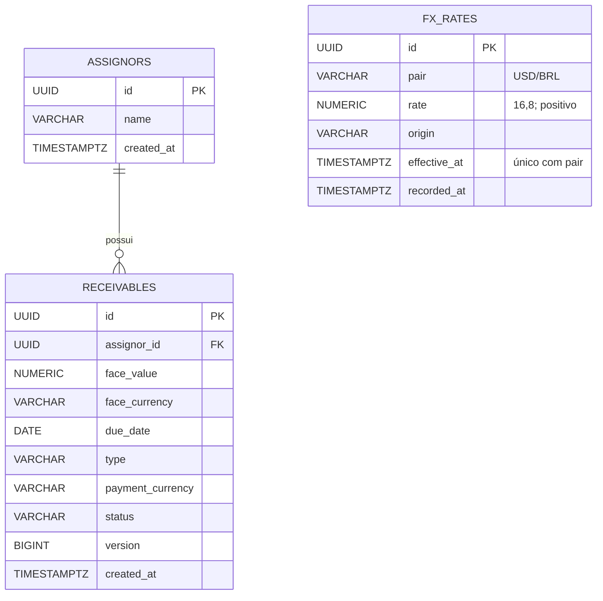

# Modelo relacional implementado

O bloco 2 implementa cedentes e recebíveis; o bloco 3 adiciona histórico de câmbio. Liquidações e idempotência serão adicionadas nas etapas correspondentes; não existem tabelas antecipadas para essas funcionalidades.

Migration: `V1__create_assignors_and_receivables.sql`. Face usa NUMERIC(18,2), com valor positivo e moeda BRL. CHECKs restringem tipo, moeda de pagamento, estado e versão. A FK impede excluir um cedente referenciado. Índices atendem consulta por cedente, estado e ordem de criação. `@Version` usa a coluna version para detecção otimista de alterações concorrentes.

A elegibilidade por vencimento é validada pela aplicação usando Clock e data de operação, sem CHECK dependente do relógio do banco. O estado SETTLED é reservado para a liquidação futura; esta etapa não oferece atualização de recebíveis.

`V2__create_fx_rates.sql` cria FX_RATES, única por `(pair, effective_at)`, com CHECK de par USD/BRL, cotação positiva e origem não vazia. NUMERIC(16,8) preserva até 99999999.99999999. Instantes têm precisão de microssegundos. O índice por par/vigência/registro atende a seleção temporal; vigências futuras são válidas para armazenamento. A futura liquidação referenciará o UUID da cotação e guardará seu snapshot. A restrição de permissões de UPDATE/DELETE pelo usuário de execução está prevista no item 4.2.

Verificação em PostgreSQL real por Testcontainers: `./mvnw -Dtest=ReceivablesIntegrationTest test`. O teste aplica a migration a banco limpo, verifica precisão, constraints, FK e conflito com uma entidade de versão antiga. A disputa entre duas liquidações pertence ao bloco 4.
