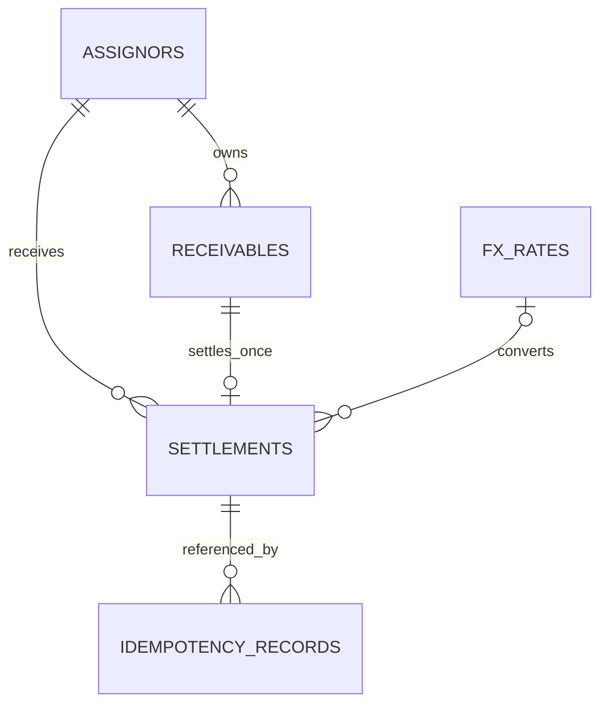
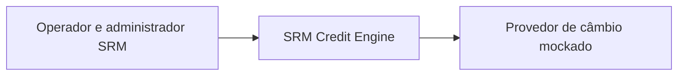
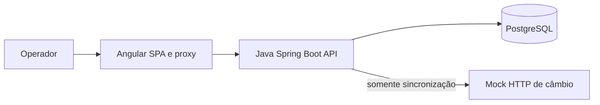

# Design

## Context

O projeto possui estrutura inicial e o bloco 2: cadastro/consulta de cedentes e recebíveis em MVC, motor decimal e prazo, migration V1, erros e correlação. Por orientação do usuário, a task 2.6 antecipa testes/cobertura/artefatos backend na CI; a suíte Angular permanece associada ao painel. Câmbio, liquidação, extrato e frontend funcional ainda serão implementados. Motivação e contratos estão na proposta e nas seis specs. As premissas foram definidas no SPEC antes do código.

## Goals / Non-Goals

**Goals:** domínio financeiro testável sem infraestrutura; consistência garantida no banco; operação local reproduzível; extensão por novas strategies sem duplicar cálculo; fluxo que o candidato consiga explicar e modificar na defesa.

**Non-Goals:** infraestrutura distribuída, pagamentos externos, contabilidade de caixa, tenancy, gestão completa de identidade, importação de arquivos, transação única para lotes ou liquidação parcial. A unicidade proposta cobre o registro interno; uma futura integração bancária precisará de protocolo próprio de idempotência e reconciliação.

## Decisions

### 1. Monólito Java e SPA Angular

Backend Spring Boot com Maven Wrapper, Spring MVC, Bean Validation, Spring Security, JPA, Flyway e JDBC para relatórios. Frontend Angular com TypeScript estrito, formulários reativos, serviços HTTP e estado local por funcionalidade. PostgreSQL é a única autoridade de persistência. Selecionar e fixar versões Java LTS/Spring Boot e Angular/Node mutuamente compatíveis na primeira tarefa técnica, após verificar documentação oficial; não usar dependências flutuantes.

O monólito reduz fronteiras de falha e permite uma transação de banco para todo o fluxo. Alternativa rejeitada: microserviços/eventos para a confirmação, que exigiriam coordenação e reconciliação sem necessidade neste case. Não haverá Redis ou broker.

Estrutura: `backend/`, `frontend/`, `docs/` e `.github/workflows/`, com Compose na raiz. Por decisão do usuário, as funcionalidades futuras deverão seguir MVC com pacotes por camada em `com.srm.credit`: `controller`, `service`, `repository`, `model`, `dto`, `config` e `exception`. Os pacotes serão criados somente quando houver implementação correspondente, sem antecipar pastas ou arquivos package-info no esqueleto. Strategies ficarão em `model.strategy`. Controllers receberão HTTP/DTOs e delegarão aos services; services coordenarão casos de uso e transações; repositories usarão JPA/JDBC; models concentrarão entidades, objetos de valor e regras. O model financeiro deverá permanecer testável sem infraestrutura. As representações REST serão DTOs JSON consumidos pelo Angular. Controllers não acessarão repositories diretamente, inclusive no extrato. Diretrizes em `docs/architecture.md`; evitar interfaces e serviços intermediários sem função concreta.

### 2. Política financeira inicial e precisão

Uma política identificada como `monthly-ceil-30d-v1` define base 0.0100, spreads 0.0150/0.0250, prazo de 1 a 36 meses e half-even. Cada strategy escolhe o spread do tipo; um único motor aplica a fórmula. Tipo não registrado é erro, nunca fallback para CHEQUE.

Premissa: títulos sempre em BRL; pagamento BRL ou USD. Prazo = teto(dias corridos/30), com data da operação obtida de `Clock` injetável em America/Sao_Paulo. O motor puro aceita meses inteiros, incluindo zero para teste; a elegibilidade rejeita vencimento no dia ou passado e prazo acima de 36. Essa convenção é uma escolha do case, não uma regra de mercado. Evitar prazo fracionário mantém potências inteiras e facilita aferição e defesa da precisão adotada.

Usar `BigDecimal` construído de strings, `MathContext` de 50 dígitos com HALF_EVEN e potência inteira; não arredondar a moeda durante a capitalização. Aplicar `setScale(2, HALF_EVEN)` ao VP em BRL; calcular deságio a partir desse VP; depois dividir pela cotação e arredondar o pagamento USD. O contexto interno é aproximação decimal de alta precisão; não equivale a aritmética racional exata. Testes devem cobrir os limites de valor, prazo e empates.

| Caso | Face BRL | Tipo | Meses | BRL por USD | VP BRL | Deságio BRL | Pagamento |
|---|---:|---|---:|---:|---:|---:|---|
| C1 | 100000.00 | DUPLICATA | 3 | — | 92859.94 | 7140.06 | BRL 92859.94 |
| C2 | 25000.00 | CHEQUE | 2 | — | 23337.77 | 1662.23 | BRL 23337.77 |
| C3 | 100000.00 | DUPLICATA | 3 | 5.4321 | 92859.94 | 7140.06 | USD 17094.67 |

DTOs aceitam e devolvem strings decimais com ponto e sem expoentes; datas civis usam ISO date e instantes usam ISO-8601 UTC. Angular normaliza a entrada pt-BR para string decimal e formata valores por manipulação de strings, sem `Number`, `parseFloat` ou cálculos monetários binários. Alternativas rejeitadas: centavos inteiros em todo o domínio, que dificultam taxas e divisão; e `double`, que viola os requisitos financeiros.

### 3. Persistência e imutabilidade

| Relação | Conteúdo e restrições principais |
|---|---|
| `assignors` | UUID, nome, timestamps; sem exclusão referenciada |
| `receivables` | UUID, FK cedente, face `NUMERIC(18,2)`, vencimento, tipo, moeda, estado, `version BIGINT`; CHECKs e FKs |
| `fx_rates` | UUID, par USD/BRL, taxa `NUMERIC(16,8)`, `effective_at`, `recorded_at`, origem; UNIQUE(par, effective_at) |
| `settlements` | UUID, UNIQUE(receivable_id), FKs, snapshots financeiros e de contexto, ator, correlationId, política, `settled_at` |
| `idempotency_records` | UNIQUE(actor_id, route, key), hash normalizado, status HTTP, corpo JSON de resposta, Location, FK liquidação, instante |

Face, VP e deságio em BRL usam `NUMERIC(18,2)`; base e spread usam `NUMERIC(10,8)`; pagamento usa `NUMERIC(30,2)` para suportar a divisão de faces máximas pela menor cotação admitida. Todos os instantes usam `TIMESTAMPTZ`. Validação antes da gravação deve rejeitar excesso de escala; não depender de coerção silenciosa de `NUMERIC`.

O cedente e o recebível são entidades normalizadas; os snapshots em `settlements` são redundância intencional para auditoria. Não há operação de edição de recebível neste escopo. Não há endpoints PUT/PATCH/DELETE de liquidação ou câmbio histórico. Um papel exclusivo executa migrations e outro executa a aplicação; o papel de execução não é dono das tabelas e não recebe UPDATE/DELETE em liquidações ou cotações. Em idempotência, DELETE é proibido e UPDATE só completa uma reserva ainda sem resultado; um trigger rejeita alteração de resultado já confirmado. Essa proteção não pretende impedir o administrador do banco.

### 4. Protocolo de liquidação e idempotência

Pedido: `{receivableId, currency, expectedPaymentAmount, expectedFxRateId?}` e `Idempotency-Key` UUID. A moeda precisa coincidir com o recebível. O operador confirma o valor indicativo; o backend é a autoridade do recálculo. A alteração da cotação selecionada ou do valor esperado devolve PRICE_CHANGED. Não há reserva de preço ou proposta com garantia temporal.

Fluxo da aplicação, com autenticação e validação sintática antes da transação:

1. Normalizar o pedido e calcular SHA-256, incluindo recebível, moeda, valor com duas casas e cotação explícita ou nula. Chave é escopada por ator estável e rota, nunca por sessão.
2. Iniciar transação READ COMMITTED e tentar reservar a chave com INSERT ON CONFLICT DO NOTHING. A linha candidata contém o hash; campos de sucesso são completados antes do commit. Não pode existir registro pendente confirmado isoladamente.
3. Em conflito de chave, ler o registro confirmado: hash diferente gera 409; hash igual reproduz status, corpo e Location originais. Esta decisão vem antes de verificar o estado atual do recebível ou buscar câmbio. Limitar a espera pela reserva a 3 segundos; timeout desfaz a transação e retorna REQUEST_IN_PROGRESS com Retry-After. Se o concorrente fizer rollback, a reserva pode prosseguir.
4. Para uma chave nova, capturar instante/data da operação, ler recebível e versão, validar estado/prazo e selecionar cotação local válida quando USD. Calcular e comparar com a confirmação do operador.
5. Atualizar estado e versão com optimistic locking (`@Version`) e forçar flush antes de inserir liquidação. Uma atualização baseada em versão antiga deve afetar zero linhas e abortar a operação. Não usar SELECT FOR UPDATE como substituto, pois o case exige demonstrar conflito otimista.
6. Inserir liquidação com snapshots e completar o resultado idempotente com identificador previamente gerado. A restrição UNIQUE(receivable_id) continua como defesa independente do ORM.
7. Commit antes da resposta. Emitir evento/log de confirmação e métrica após commit. Exceções são mapeadas fora da transação abortada; não tentar recuperar uma transação PostgreSQL que já falhou.

Na disputa com chaves diferentes, o perdedor recebe RECEIVABLE_ALREADY_SETTLED e sua reserva é desfeita. Uma falha antes do commit não consome a chave; corrigido o problema, ela pode ser reutilizada. Somente sucessos são retidos nesta versão. Registros idempotentes confirmados não expiram. Não há promessa de execução exatamente uma vez fora deste banco.

O teste de concorrência usa duas conexões/transações reais e uma barreira após ambas lerem a mesma versão. As duas são liberadas juntas; verificar um commit, um conflito, um registro de liquidação e um incremento de versão. O controle da barreira deve ficar no harness de teste, sem sleeps ou endpoint especial na aplicação.

### 5. Câmbio como atualização separada da confirmação

Selecionar `effective_at <= operationAt` e `recorded_at <= operationAt`, ordenado por vigência decrescente, ignorando registros ainda não visíveis. Aceitar idade de até 24 horas. Guardar identificador, valor e vigência no snapshot. A direção é BRL por USD, portanto converter dividindo. Vigência futura pode ser cadastrada, mas não antecipada na seleção.

Sincronização é uma operação administrativa separada. O adapter HTTP chama o mock com timeout de 1 segundo, até duas tentativas totais e backoff fixo de 100 ms; não repetir erros 4xx ou payload inválido. Repetição da mesma cotação do provedor não gera nova linha: retornar o registro existente se par, vigência e valor coincidirem; valor divergente para a mesma vigência gera 409. Nunca chamar o provedor dentro da transação de liquidação.

Alternativa rejeitada: buscar latest remoto a cada liquidação, pois vincula disponibilidade e tempo de lock ao provedor. Se ele cair, cotação local válida permite operar; sem cotação válida, USD falha com 503 e BRL continua. Não há fallback silencioso para cotação antiga.

### 6. Contrato REST e extrato

| Rota `/api/v1` | Comportamento |
|---|---|
| `GET /auth/csrf`, `POST /auth/login`, `GET /auth/me`, `POST /auth/logout` | Token CSRF, sessão, identidade/papel e encerramento |
| `GET/POST /assignors` | Consulta e cadastro simples de cedentes |
| `GET/POST /receivables`, `GET /receivables/{id}` | Cadastro e consulta paginada, incluindo filtro de estado |
| `POST /pricing/simulations` | Entrada do formulário, resultado indicativo sem gravação financeira |
| `GET /fx-rates`, `GET /fx-rates/current`, `POST /fx-rates` | Histórico paginado, vigente e atualização administrativa |
| `POST /fx-rates/sync` | Sincronização administrativa resiliente; 200 se já existia, 201 se criada |
| `POST /settlements`, `GET /settlements/{id}` | Confirmação idempotente e consulta do snapshot |
| `GET /settlements` | Extrato paginado com filtros e totais por moeda |

Documentar payloads, exemplos, cabeçalhos e códigos no OpenAPI. Global exception handler produz Problem Details com `code`, `correlationId` e erros de campo quando houver. Criações retornam Location. A referência inexistente de cedente em um cadastro é erro de campo 400; consulta de recurso inexistente é 404. Não expor detalhes SQL.

Extrato usa JDBC com SQL parametrizado, filtros opcionais montados por fragmentos controlados e ordenação fixa. Página, contagem e totais são lidos na mesma transação read-only REPEATABLE READ para consistência da resposta; navegação entre páginas não promete snapshot entre requisições. Datas escolhidas no painel são convertidas dos limites civis em São Paulo para UTC, incluindo o dia final por um limite exclusivo no dia seguinte.

Índices iniciais: `(settled_at DESC, id DESC)`, `(assignor_id, settled_at DESC, id DESC)`, `(payment_currency, settled_at DESC, id DESC)` e `(pair, effective_at DESC)` para câmbio. Validar com EXPLAIN ANALYZE na massa de aferição; acrescentar índice combinado somente se a consulta justificar. Limite de período de 366 dias e página até 100 evitam consultas sem limites.

### 7. Segurança e frontend

Sessão Spring Security e dois usuários/papéis configurados externamente: OPERATOR e ADMIN, sendo ADMIN também operador. Todos veem o mesmo fundo/cedentes nesta demonstração; não há isolamento multitenant. Credenciais são verificadas com hash apropriado, não ficam em Git ou localStorage. Login usa o fluxo de autenticação do framework para manter proteção contra fixação de sessão. CSRF vale também para login/logout; renovar o token após autenticação.

Servir frontend e API pela mesma origem via proxy. Cookies HttpOnly e SameSite=Lax; Secure em HTTPS, com exceção explícita para desenvolvimento local em HTTP. Não abrir CORS irrestrito. Expor externamente apenas health sem detalhes; métricas e OpenAPI ficam protegidos. O limite de produção deste modelo de identidade deve constar em DECISIONS.md.

Angular organiza componentes de apresentação, serviços de API e estado do fluxo. `debounceTime(300)` e `switchMap` evitam respostas de simulação obsoletas; limpar o resultado ao invalidar entradas. Estados locais: edição, simulando, pronto, confirmando, confirmado e falha. Uma intenção guarda corpo/chave em memória para retry; mudança do corpo após PRICE_CHANGED gera nova intenção. Após recarga, consultar histórico/recebível antes de repetir. Sem gerenciador de estado global nesta versão.

### 8. Observabilidade, testes e entrega

Logs JSON com correlationId; validar tamanho/formato de correlationId recebido ou gerar novo UUID. Registrar sucesso apenas após commit. Métricas via Micrometer/Actuator: `settlements.confirmed` por moeda e `pricing.duration`; não usar IDs de usuário, recebível ou chave como labels. O contador em memória pode perder eventos entre commit e emissão ou ao reiniciar; extrato SQL é a autoridade de reconciliação.

Testes unitários cobrem strategies, golden cases, teto de prazo, clock, limites e arredondamento. Integração com Testcontainers/PostgreSQL cobre migrations, papéis, rollback, seleção temporal, replay e concorrência. HTTP mock verifica timeout/retry e indisponibilidade. Angular testa validação, cancelamento de resposta antiga e chave persistente no retry. Um smoke de navegador percorre login, simulação, confirmação e extrato.

CI executa lint/build/test dos dois projetos e integrações PostgreSQL. Testes não devem substituir PostgreSQL por H2. Compose sobe frontend, API, banco e mock com healthchecks, volume e variáveis documentadas. Dados demonstrativos são explícitos e opcionais; câmbio atual para demonstração deve ser inserido com vigência atual, pois seeds antigas expiram em 24 horas.

Aferição de desempenho usa o cenário e os alvos da spec operational-readiness; registrar resultados reais, hardware e queries, sem prometer throughput de produção. README apresenta setup, design, testes e GitHub Flow com branches por funcionalidade, conventional commits e integração por pull requests. As descrições de PR devem explicar problema, decisão e validação. REVIEW.md prioriza SQL injection, duplicidade, ausência de transação/falso sucesso e cálculo incorreto. AI_USAGE.md registra decisões e falhas reais ao longo do trabalho; nenhum requisito pendente pode ser apresentado como já validado.

### 9. Visões C4

Contexto (nível 1):

Contêineres (nível 2):

Os diagramas finais serão criados em docs/c4.md e docs/er.md, ligados no README, e deverão distinguir SPA no navegador, nginx, API, PostgreSQL, bootstrap e provedor mockado.

## Risks / Trade-offs

- [Prazo por teto/30 pode divergir da expectativa comercial] → Explicitar em SPEC.md e no painel; defender como premissa revisável e manter testes para trocar a convenção.
- [O conjunto de requisitos pode exceder a estimativa de 8–16 horas] → Implementar primeiro motor e integridade; manter interface funcional simples; documentar cortes sem remover as garantias transacionais.
- [Offset pagination muda entre requisições com novas inserções] → Ordenação determinística e snapshot por resposta; documentar a limitação; cursor fica como evolução.
- [Retenção idempotente e auditoria crescem indefinidamente] → Aceitar para o case; política de retenção futura exige preservar unicidade de liquidação e contratos de replay.
- [Cotações de 24 horas e limite de prazo são políticas arbitradas] → Tornar explícitas e versionadas; alteração exige atualizar contrato, testes e parâmetros auditados.
- [Papéis de banco podem ser esquecidos no setup] → Verificar restrições usando a credencial real da aplicação em teste de integração e Compose.
- [Controle de acesso simplificado] → Uso demonstrativo; federação de identidade, rotação e governança de acesso ficam documentadas como evolução.

## Migration Plan

Não existem dados a migrar. Criar migrations versionadas e reexecutáveis em banco limpo, com papéis separados; inicializar dados opcionais por procedimento explícito. O primeiro ambiente será local via Compose. Antes da primeira publicação, executar CI, smoke e aferição e atualizar documentação com os resultados. Rollback da aplicação não deve apagar liquidações; mudanças de esquema futuras devem preservar leitura do histórico. Reset de volume fica restrito ao ambiente descartável e deve ser documentado como destrutivo.
